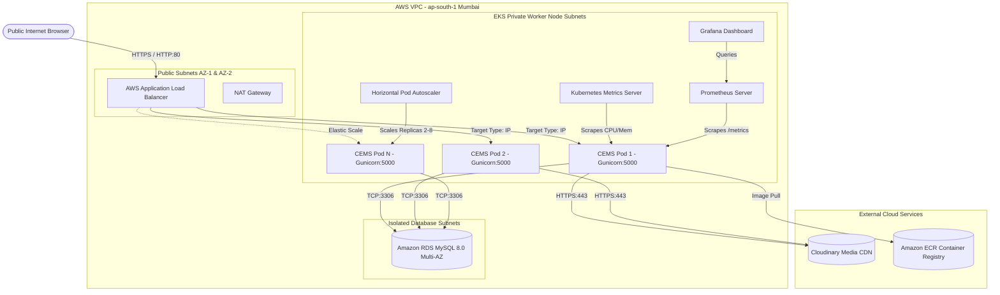
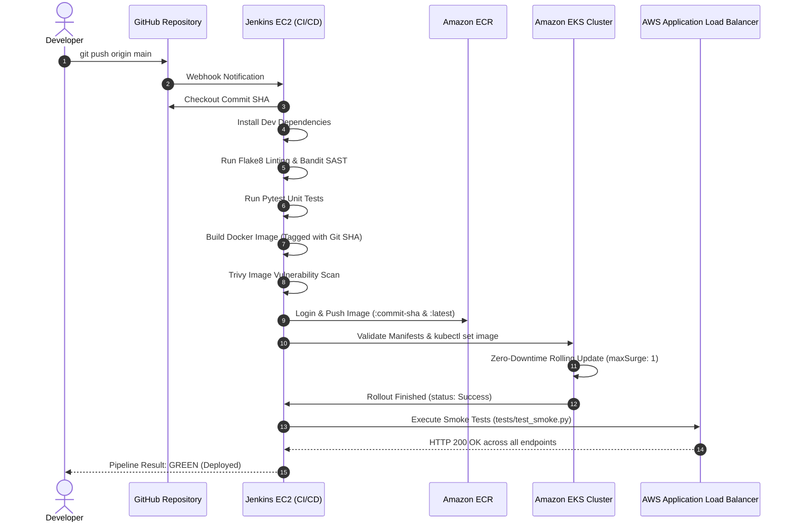

# CEMS Production DevOps & Cloud Architecture

## 1. Executive Summary

The Campus Event Management System (CEMS) is containerized and deployed to Amazon Web Services (AWS) using industry-standard cloud-native patterns. The architecture prioritizes high availability, zero-downtime rolling updates, automated elastic scaling, security isolation, and observability.

---

## 2. Architectural Analysis: Monolith vs. Microservices / Decoupled Frontend

### Inspected Existing Codebase
- **Framework**: Python 3.11 with Flask 2.3.3 / Werkzeug.
- **Frontend Presentation**: Jinja2 server-side rendering (SSR) templates located in `templates/` with static assets in `static/` (CSS, JavaScript, and images).
- **Session & Security**: Server-managed HTTP cookie sessions (`SESSION_COOKIE_HTTPONLY`, `SESSION_COOKIE_SECURE`, `SESSION_COOKIE_SAMESITE`), synchronized with Flask-WTF CSRF tokens embedded into HTML forms.
- **Data Layer**: Direct MySQL queries through a request-scoped `DBWrapper` in `app.py`.
- **Media Assets**: Cloudinary cloud storage integration for persistent gallery images.
- **Pass Generation**: Stateless in-memory PDF streaming via ReportLab (`io.BytesIO()`).

### Evaluation of Options
1. **Option A: Refactor into Separate Frontend (SPA) and Backend (REST API)**
   - *Impact*: Requires rewriting over 2,500 lines of Flask route handlers into JSON endpoints, rewriting 11 HTML/Jinja2 pages into React/Vue/Next.js, replacing cookie-based sessions with JWT/OAuth2 tokens, and re-architecting CSRF protection.
   - *Risk*: High risk of introducing functional regressions, breaking PDF downloads, disrupting student registrations, and adding unnecessary maintenance overhead for an academic project.

2. **Option B (Selected Architecture): Production Container with Reverse Proxy / Ingress Routing**
   - *Design*: The Flask application is packaged into a hardened, non-root, multi-stage Docker container served by Gunicorn (`gthread` worker model). Public traffic is routed through the AWS Load Balancer Controller managing an Application Load Balancer (ALB).
   - *Benefits*: 100% preservation of existing business logic, robust CSRF and session handling, stateless pod scaling, and zero code rewrite required.

---

## 3. High-Level System Architecture Diagram

---

## 4. Component Deep Dive

### 4.1. Ingress and Routing (AWS Load Balancer Controller)
- The AWS Load Balancer Controller provisions an Application Load Balancer (ALB) outside the Kubernetes cluster in public subnets across two Availability Zones (`ap-south-1a` and `ap-south-1b`).
- Target Type is configured as `ip`. The ALB routes traffic directly to the private IP addresses of the application pods via AWS VPC CNI, eliminating the latency and overhead of `NodePort` or `kube-proxy` hops.
- Health checks are mapped directly to `/health` on port 5000 with a 15-second interval and 2 consecutive healthy thresholds.

### 4.2. Application Pod Layer (EKS)
- **Base Image**: `python:3.11-slim` multi-stage build.
- **Process Manager**: Gunicorn WSGI server utilizing the `gthread` worker class with 3 worker processes and 2 threads per worker.
- **Security Context**: Dedicated non-root user `cemsuser` (UID: 10001, GID: 10001) with all Linux capabilities dropped (`drop: ["ALL"]`) and `allowPrivilegeEscalation: false`.
- **Stateless Operation**: Image uploads are dispatched to Cloudinary CDN, PDF passes are rendered in memory, and session state is encapsulated in secure client cookies. No state is stored on the local container filesystem.

### 4.3. Database Architecture (Dual Modes)

#### Mode A: Local Development (Docker Compose)
- MySQL 8.0 container running on bridge network `cems-network`.
- Data persistence guaranteed through a named Docker volume (`cems_mysql_data:/var/lib/mysql`).
- Automatic schema initialization via `./scripts/init_mysql.sql` mounted into `/docker-entrypoint-initdb.d/`.

#### Mode B: AWS Production (Amazon RDS for MySQL)
- Managed MySQL 8.0 deployed in private database subnets with no public IP.
- Automated daily snapshots, automated patching, and Multi-AZ replication option.
- Security Group allows inbound port 3306 only from the EKS worker nodes' security group.

#### College Demonstration Fallback (Kubernetes StatefulSet)
- If the project evaluation requires MySQL inside Kubernetes, manifests in `k8s/database/` provide:
  - `mysql-statefulset.yaml`: Stable network identity `mysql-0.mysql-service.cems.svc.cluster.local`.
  - `mysql-pvc.yaml`: PersistentVolumeClaim backed by AWS EBS `gp3` storage class.

---

## 5. Elastic Scaling & Self-Healing Architecture

### 5.1. Horizontal Pod Autoscaler (HPA)
- Target: `cems-deployment`.
- Min Replicas: 2 | Max Replicas: 8.
- Triggers:
  - Average CPU Utilization > 70% of requested CPU (250m).
  - Average Memory Utilization > 80% of requested Memory (256Mi).
- Stabilization: Scale-up is immediate; scale-down incorporates a 300-second stabilization window to prevent flapping.

### 5.2. Pod-Level Self-Healing
- **Process Failure**: If Gunicorn crashes, the container exits with a non-zero code. Kubernetes `restartPolicy: Always` immediately restarts the container.
- **Unresponsive / Deadlock**: If application worker threads hang, the `livenessProbe` fails 3 times consecutively (45s). The kubelet kills the container and starts a fresh instance.
- **Traffic Removal**: When a pod starts or undergoes high load, the `readinessProbe` marks it unready. The endpoints controller immediately removes its IP from the ALB target group until it recovers.
- **Node Failure**: If an EC2 worker node fails or is terminated, the Kubernetes control plane reconciles desired replicas and reschedules pods onto surviving nodes.

---

## 6. CI/CD Architecture (Jenkins & Amazon ECR)

---

## 7. Monitoring & Observability Architecture

- **Prometheus Operator**: Deployed via `kube-prometheus-stack` Helm chart.
- **ServiceMonitor**: Discovers `cems-service` in namespace `cems` and scrapes the `/metrics` endpoint every 15 seconds.
- **Application Metrics**: Instrumented via `prometheus_flask_exporter`, exporting request count, HTTP status codes, latency histograms, and process memory.
- **Infrastructure Metrics**: `node-exporter` collects EC2 CPU/RAM/Disk metrics; `kube-state-metrics` tracks replica counts, pod restarts, and HPA status.
- **Grafana**: Pre-configured dashboard visualizes throughput, error rates, P95 latency, and pod memory against limits.
- **Alertmanager**: Triggers alerts for pod restart spikes, replica downtime, and high error rates.
